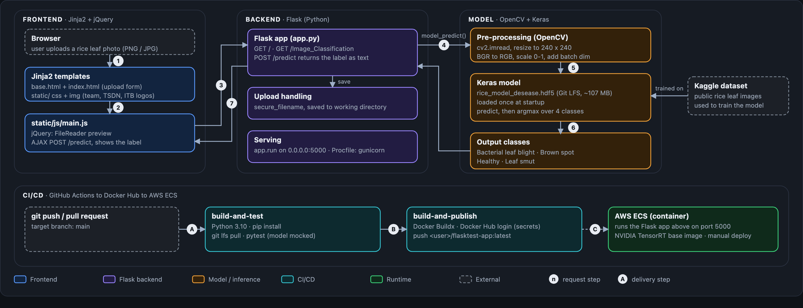

# Rice Image Classification Website Based on Deep Learning with Flask 🐍

This project is a **Rice Image Classification** website designed to recognize diseases in rice leaves using a deep learning model. It was presented at **TSDN 2022** and successfully made it to the finals among dozens of teams. The application is built with **Flask** and is deployed using a **CI/CD pipeline with Docker**, hosted on **AWS Elastic Container Service (ECS)**.

## Features
- **Image Classification**: Detects and classifies various rice leaf diseases.
- **Automated Deployment**: Continuous Integration and Continuous Deployment (CI/CD) pipeline ensures seamless updates.
- **Containerization**: Docker ensures consistent environments across development and production.
- **Cloud Deployment**: Hosted on AWS ECS for scalability and reliability (still manual)

## Architecture

The app is a small Flask service. A Jinja2 page with jQuery uploads a photo, Flask pre-processes it with OpenCV, and a Keras model returns one of four rice leaf classes. GitHub Actions tests the code and publishes a Docker image, which runs on AWS ECS.



### Components

| Layer | Technology | Responsibility |
|---|---|---|
| Frontend | Jinja2 templates (`templates/`), jQuery (`static/js/main.js`), CSS | Upload form, image preview, AJAX call to `/predict`, result display |
| Backend | Flask (`app.py`) | Routes, upload handling, calls `model_predict()` |
| Model | OpenCV, Keras / TensorFlow, `rice_model_desease.hdf5` (Git LFS) | Reads a 240 x 240 RGB image and predicts one of four classes |
| CI/CD | GitHub Actions, `pytest`, Docker Buildx, Docker Hub | Runs tests, then builds and pushes the Docker image |
| Runtime | Docker (NVIDIA TensorRT base image), AWS ECS | Serves the app on port 5000. The ECS deployment is still manual |

### Routes

| Route | Method | Description |
|---|---|---|
| `/` | GET | Health check, returns `Server is running!` |
| `/Image_Classification` | GET | Upload page |
| `/predict` | POST | Multipart field `file` (PNG or JPG). Returns the predicted label as plain text |

The model classifies four classes: **Bacterial leaf blight**, **Brown spot**, **Healthy** and **Leaf smut**. It was trained on a public Kaggle rice leaf dataset.

### Request flow

1. The browser opens `GET /Image_Classification` and Flask renders `index.html`.
2. The user picks a PNG or JPG, and `main.js` shows a preview with `FileReader`.
3. "Predict!" posts the file as multipart form data to `POST /predict` (AJAX).
4. Flask saves the upload (`secure_filename`) and calls `model_predict()`.
5. OpenCV reads the image, resizes it to 240 x 240, converts BGR to RGB and scales values to 0-1.
6. The Keras model (loaded once at startup) predicts, and `argmax` picks one of the four classes.
7. Flask returns the label as plain text and `main.js` shows it as the result.

### Delivery pipeline

- **A.** A push or pull request to `main` starts the workflow in `.github/workflows/main.yml`.
- **B.** `build-and-test` installs the dependencies, runs `git lfs pull` and `pytest` (three tests, with the model mocked). When it passes, `build-and-publish` builds the image with Docker Buildx and pushes `<user>/flasktest-app:latest` to Docker Hub.
- **C.** The image runs on AWS ECS. This last step is still manual.

## Prerequisites

Make sure you have the following prerequisites installed before proceeding:

- **Docker**: Ensure Docker is installed on your machine. [Install Docker](https://docs.docker.com/get-docker/)
- **AWS Account**: Set up an AWS account to deploy on ECS. [Sign Up for AWS](https://aws.amazon.com/)
- **Git**: Version control with Git. [Install Git](https://git-scm.com/book/en/v2/Getting-Started-Installing-Git)

## Run locally

The model file is stored with Git LFS, so run `git lfs pull` after cloning. CI uses Python 3.10.

```bash
git clone https://github.com/aprmswra/image-classifier-tsdn.git
cd image-classifier-tsdn
git lfs pull                                     # downloads rice_model_desease.hdf5 (~107 MB)
python -m venv venv && source venv/bin/activate
pip install -r requirements.txt
python app.py                                    # http://localhost:5000/Image_Classification
pytest                                           # run the tests
```

With Docker: `docker compose up --build`. The compose file reserves an NVIDIA GPU (`runtime: nvidia`), so it needs the NVIDIA container toolkit on the host.

## License

This project is licensed under the [MIT License](LICENSE).

### Model Implementation Code Reference

<a href="https://sourcerer.io/spidy20"></a>
